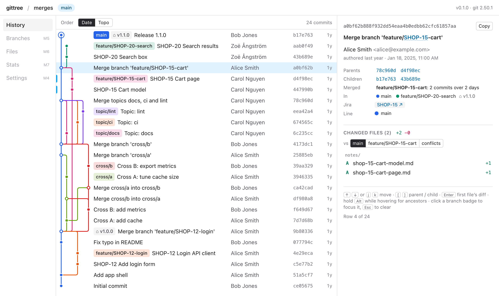

# gittree

A local, interactive explorer for git history. Run `gittree` in a repository and read its branches, merges and
diffs in your browser. It runs on your own machine, only reads your repository, and needs no account.



> **Status:** early development (v0.1.0). The History view (commit graph, search, commit details and diffs) works.
> Path and content search, simplified graph views, Branches, File history & blame, Stats and Settings come next; see
> the [roadmap](#roadmap).

- [Features](#features)
- [Requirements](#requirements)
- [Installation](#installation)
- [Usage](#usage)
- [Keyboard shortcuts](#keyboard-shortcuts)
- [Configuration](#configuration)
- [Safety and security](#safety-and-security)
- [Troubleshooting](#troubleshooting)
- [Development](#development)
- [Roadmap](#roadmap)
- [Contributing](#contributing)
- [License](#license)

## Features

### Commit graph

- Local branches, remote branches, tags and HEAD in one graph: lanes on the left, the commit list beside them.
  The default branch (`origin/HEAD`, else `main`, `master` or `develop`) is always the straight line in the first
  lane.
- **Date** order (newest first: what happened when) or **Topo** order (each branch's commits kept together, fewer
  crossings).
- Each branch line has its own color. Badges mark local branches, remote branches (dashed) and tags (⌂); the
  checked-out branch is filled in. A branch and its remote twin at the same commit share one badge, marked ⇅.
- Commits of branches that were merged and then deleted keep a named line, read from the merge message
  (`Merge branch 'x'`, GitHub's `Merge pull request #12 from …`, Bitbucket's `Merged in …`).
- **Hover** a commit and its branch line lights up while the rest dims. Hold **Alt/⌥** to light up all of its
  ancestors instead.
- **Focus a branch** by clicking its badge: its own commits stay lit, its fork point and merge are marked, and the
  toolbar sums it up (`3 own commits · forked from 1a2b3c4 · merged in 5d6e7f8`).
- Built for histories of up to 10,000 commits: rows are virtualized and the lane layout runs in a Web Worker.
  Larger repositories show their newest 10,000 commits, with a note giving the total.
- Handles detached HEAD, shallow and partial clones, bare repositories, linked worktrees, submodules, multiple root
  commits and empty repositories.

### Search

- One search bar above the commit list (press <kbd>/</kbd>). Free text matches subjects, message bodies, hash
  prefixes and branch or tag names; tokens narrow the search down:

  | Token | Matches |
  |---|---|
  | `author:alice` | Author name or email (after `.mailmap`) |
  | `after:2025-03-01` · `before:1y` | Author date on or after / before a date (`YYYY-MM-DD`, `today`, `yesterday`) or an age (`3d`, `2w`, `6m`, `1y`) |
  | `ref:release/*` | Commits a branch or tag points at; `*` and `?` match anything, and `origin/x` also matches as `x` |
  | `jira:SHOP-12` · `jira:SHOP` | Commits that mention the issue (or any issue of the project), and the commits of branches named after it |
  | `merges:only` · `merges:none` | Only merge commits, or no merge commits |
  | `"fix login"` | A phrase; quotes also hold values with spaces: `author:"Alice Smith"` |
  | `-term` | Leaves out what the term matches: `-author:bob`, `-wip` |

- Every term has to match; the same token twice matches either value (`author:alice author:bob`).
- **Matches: Dim** keeps the whole graph and dims the other commits; **Hide** shows only the matches, laid out on
  their own and linked through the commits in between.
- Suggestions complete token names, authors (most commits first), branches and tags, Jira keys and dates.
  <kbd>Enter</kbd> jumps to the first match, and <kbd>n</kbd> / <kbd>N</kbd> step through the matches.
- Outside the bar, the query shows as chips: click one to edit it, ✕ to remove it. Terms that can't be used are
  marked in red and left out of the search.
- **Tickets** lists the Jira issues in the history with their commit counts; pick one to search for it.
- It all runs in the browser on the loaded history. Message bodies load in the background the first time you use
  the search. Searching file paths and contents (`path:`, `content:`, `regex:`) comes next.

### Commit details

- The full message, with web links and Jira keys turned into links.
- Author and committer, shown separately when they differ (as after a rebase or cherry-pick), with relative and
  absolute dates. Hover a date for the time in that person's own time zone.
- Parents and children as links, the refs pointing at the commit, and the branches and tags that contain it.
- For a merge: which branch it brought in, how many commits and over how long (`feature/login: 12 commits over 3
  days`). Those commits are marked in the graph; hover the summary to light them up.
- Changed files grouped by folder, with their status (added, modified, deleted, renamed with similarity, copied,
  type changed) and `+`/`−` line counts.
- Copy buttons for the hash and file paths, and a link to the commit on its hosting service: GitHub, GitLab,
  Bitbucket (cloud and Server/Data Center), Azure DevOps, Codeberg, Gitea/Forgejo or SourceHut, recognized from
  the URL of the `origin` remote (else `upstream`, else the first remote). The link is built locally: no API
  calls, and credentials in a remote URL never end up in it.

### Diffs

- gittree's own diff viewer, split or unified. Your choice is remembered; until you make one, diffs are split on
  screens at least 1280 px wide.
- Syntax highlighting for every language [Shiki](https://shiki.style) supports, computed in a Web Worker, plus
  word-level highlights inside changed lines.
- Files up to 1 MiB come with the whole file as context: unchanged runs fold around each change and unfold 20
  lines at a time or all at once, without another request. Larger files get 3 lines of context.
- Ignore whitespace (`git diff -w`).
- Merge commits: compare with any parent (the first one by default: "what this merge brought in"), or show the
  **conflict resolutions** (`git diff --cc`), only the lines that differ from every parent.
- Binary files show their sizes; mode changes, symlinks and submodules are labeled; diffs with more than 2,000
  changed lines wait for a click on **Load diff**.

### Jira links

- Issue keys in commit messages and branch names (`feature/SHOP-123-login`) are picked up, and become links once
  you tell gittree where your Jira is (see [Configuration](#configuration)).
- With your project keys configured, only those match. Without them, a generic `ABC-123` pattern skips
  look-alikes such as `UTF-8`, `SHA-256` and `ISO-8601`.
- No Jira API calls, no tokens.

### Getting around

- Fully usable from the keyboard; see [Keyboard shortcuts](#keyboard-shortcuts).
- The URL holds the view: selected commit, graph order, focused branch, search, comparison and open diff. A reload keeps
  your place, and the browser's Back and Forward buttons retrace your exploration
  (see [URL parameters](#url-parameters)).
- Follows your system's light or dark theme.

## Requirements

- **macOS.** That's where gittree is built and tested. Linux should work but hasn't been tested yet.
- **Node.js 22.18** or newer.
- **pnpm 12** ([installation](https://pnpm.io/installation)). The exact version is pinned in `package.json`.
- **git 2.30** or newer. gittree checks the version when it starts. Partial clones stay offline only with git 2.44
  or newer (see [Safety and security](#safety-and-security)).

## Installation

gittree isn't published to npm yet. Install it from source:

```bash
git clone <repository-url> gittree
cd gittree
pnpm install
pnpm build
```

pnpm may list `@tanstack/react-router` and `tsdown` under "Packages awaiting approval". They ship optional agent
skills that gittree's build doesn't need, so you can leave them unapproved.

pnpm 12 has no `pnpm link --global`, so put the `gittree` command on your `PATH` by linking the built CLI into a
folder that's on it:

```bash
mkdir -p ~/.local/bin
ln -s "$PWD/dist/server/cli.js" ~/.local/bin/gittree
```

If `~/.local/bin` isn't on your `PATH` yet, add `export PATH="$HOME/.local/bin:$PATH"` to your shell profile
(such as `~/.zshrc`). Check it with `gittree --version`. To update later, run `git pull`, `pnpm install` and
`pnpm build`; the link keeps working.

You can also skip the link and run gittree from its own folder with `pnpm start`. Relative paths are then
relative to the gittree folder, and options go right after the path, without a `--`:

```bash
pnpm start ~/code/shop --port 4790
```

## Usage

```bash
gittree                       # the repository you're in
gittree ~/code/shop           # any folder inside a repository
gittree ~/code/shop -p 4790   # on a fixed port
gittree --no-open             # print the sign-in link instead of opening the browser
```

gittree finds the repository the path belongs to (a work tree or any folder in it, a linked worktree, a `.git`
folder or a bare repository), starts a server on `127.0.0.1` and opens the History view in your default browser:

```text
gittree 0.1.0 · shop (/Users/you/code/shop)
Listening on http://127.0.0.1:52817. Open this one-time sign-in link:

  http://127.0.0.1:52817/auth?token=…

Press Ctrl+C to stop.
```

Press **Ctrl+C** to stop it. Each run serves one repository on its own port; to look at two repositories at once,
run gittree twice.

| Option | Description |
|---|---|
| `[path]` | The repository to open. Default: the current folder |
| `-p`, `--port <n>` | Port to listen on. Default: a random free port |
| `--no-open` | Don't open the browser; just print the sign-in link |
| `--verbose` | Log every request |
| `-v`, `--version` | Print the version |
| `-h`, `--help` | Show the help |

### Signing in

Your browser gets into gittree through the sign-in link, which works once: gittree swaps it for a cookie, and
turns away other browsers, private windows and other web pages. Opening the link again in the same browser just
continues. Each run has its own sign-in, so after a restart use the new link (gittree opens it for you unless you
pass `--no-open`).

With a fixed `--port`, bookmarks keep working across restarts once you've signed in with the new link, and so
does your split/unified choice, which browsers store per port.

### The History view

The left column lists the views. **History** works today; the others show the milestone they arrive in. The
header shows the repository, the checked-out branch, and flags such as *shallow clone*.

1. **Read the topology.** Hover commits to follow their branch lines, and hold Alt/⌥ to see a commit's
   ancestors. Switch between **Date** and **Topo** order in the toolbar.
2. **Inspect a commit.** Click it, or move with ↑/↓ or j/k. The panel on the right shows its message, people,
   relations, Jira keys and changed files.
3. **Find something.** Press / and type, for example `author:alice login` or `jira:SHOP-12 -merges:only`. The
   matches stay lit while the rest dims; switch **Matches** to **Hide** to see only them. Enter jumps to the first
   match, n and N step through the others.
4. **Read a diff.** Click a file, or press Enter for the first one. The diff widens across most of the window,
   with the commit's files beside it: j/k switch files, `[` and `]` switch commits, Esc goes back to the details.
5. **Follow a branch.** Click a branch badge to focus it; the toolbar shows its own commits, fork point and
   merge. Click the badge again or press Esc to clear the focus.
6. **Look inside a merge.** Merges get a **vs** switch above their files: compare with each parent, or pick
   **conflicts** to see only how conflicts were resolved.

### URL parameters

Every view has a link like `http://127.0.0.1:<port>/r/<repo-id>/history?sel=a0bf62b&file=src/app.ts`, where
`<repo-id>` is a short hash of the repository's path, so raw paths never appear in URLs.

| Parameter | Meaning |
|---|---|
| `sel` | Selected commit: a full or abbreviated hash (at least 4 characters). Default: HEAD |
| `order=topo` | Topo order. Default: date order |
| `focus` | Focused branch, such as `feature/login` |
| `parent` | For a merge: compare with parent `2`, `3`, …, or `cc` for its conflict resolutions. Default: the first parent |
| `file` | Path of the file whose diff is open |
| `ws=1` | Ignore whitespace in the diff |
| `q` | Search query, such as `author:alice jira:SHOP-12` |
| `matches=hide` | Show only the commits the search matches. Default: dim the others |

## Keyboard shortcuts

**Commit list**

| Key | Action |
|---|---|
| <kbd>↓</kbd> <kbd>↑</kbd> or <kbd>j</kbd> <kbd>k</kbd> | Next / previous commit |
| <kbd>PageDown</kbd> <kbd>PageUp</kbd> | 20 commits down / up |
| <kbd>Home</kbd> <kbd>End</kbd> | Top / bottom of the list |
| <kbd>[</kbd> | First parent |
| <kbd>]</kbd> | Child, preferring the one on the same branch line |
| <kbd>Enter</kbd> | Open the first changed file's diff |
| <kbd>Esc</kbd> | Clear the branch focus |
| <kbd>/</kbd> | Go to the search bar |
| <kbd>n</kbd> <kbd>N</kbd> | Next / previous search match |
| Hold <kbd>Alt</kbd>/<kbd>⌥</kbd> while hovering | Light up all ancestors of the hovered commit |

**In the search bar**

| Key | Action |
|---|---|
| <kbd>↓</kbd> <kbd>↑</kbd> | Choose a suggestion |
| <kbd>Tab</kbd> | Complete with the chosen (or first) suggestion |
| <kbd>Enter</kbd> | Take the chosen suggestion; without one, jump to the first match |
| <kbd>Esc</kbd> | Close the suggestions; again to go back to the commit list |

**With a diff open**

| Key | Action |
|---|---|
| <kbd>j</kbd> <kbd>k</kbd> | Next / previous changed file |
| <kbd>[</kbd> <kbd>]</kbd> | Parent / child commit: stays on the same file if that commit changed it, otherwise opens its first file |
| <kbd>↑</kbd> <kbd>↓</kbd> <kbd>PageUp</kbd> <kbd>PageDown</kbd> <kbd>Home</kbd> <kbd>End</kbd> | Scroll the diff (while the commit list has the focus, they move between commits instead) |
| <kbd>Esc</kbd> | Close the diff and go back to the commit details |

Shortcuts don't fire while you type in a text field or hold <kbd>Cmd</kbd>, <kbd>Ctrl</kbd> or <kbd>Alt</kbd>, so
browser shortcuts keep working; <kbd>Enter</kbd> on a focused button or link presses it. Clicking a commit or
jumping with <kbd>[</kbd> <kbd>]</kbd> adds a browser history entry, while stepping with the arrow keys or
<kbd>j</kbd> <kbd>k</kbd> doesn't, so Back retraces your jumps rather than every step.

**Mouse**

| Do this | To |
|---|---|
| Hover a commit | Light up its branch line and dim the rest (not while a search dims commits or a branch is focused) |
| Click a commit | Select it and show its details |
| Click a branch badge | Focus that branch; click again to clear (the default branch and tags can't be focused) |
| Click a branch under **In** in the details | Focus that branch |
| Hover **Merged** in a merge's details | Light up the commits it brought in |
| Click a search chip | Edit the query there; its ✕ removes that term |
| Click **Tickets**, then an issue | Search for that Jira issue; click it again to drop it |
| Click a changed file | Open its diff |
| Click **↓ 20**, **↑ 20** or **⋯ N unchanged lines** in a diff | Unfold the context around a change |

## Configuration

gittree reads its settings from `~/.config/gittree/config.json` (`$XDG_CONFIG_HOME/gittree/config.json` when
`XDG_CONFIG_HOME` is set), never from inside your repositories. For now the file only holds the Jira settings and
is edited by hand. gittree reads it again whenever the page loads, so reload the page after a change; no restart
needed.

```json
{
  "jira": {
    "baseUrl": "https://your-company.atlassian.net",
    "projectKeys": ["SHOP", "OPS"]
  }
}
```

| Key | Meaning |
|---|---|
| `jira.baseUrl` | Your Jira's http(s) address. Issue keys link to `<baseUrl>/browse/<KEY>` |
| `jira.projectKeys` | Project keys to look for, as a list or one string (`"SHOP, OPS"`). Without them, gittree uses a generic pattern |

Invalid values are skipped rather than fatal; see [Troubleshooting](#troubleshooting) for how to list what was
skipped. A Settings view arrives with [M4](#roadmap).

## Safety and security

gittree is designed to be safe to point at any repository on your machine.

**It only reads.**

- git runs through a fixed allowlist of read-only commands (`log`, `diff-tree`, `rev-parse`, `for-each-ref`,
  `cat-file`, …). Arguments are passed as arrays, never through a shell, and refs and paths that come from the
  browser are fenced off behind `--end-of-options` and `--`.
- It never takes git's optional locks (`GIT_OPTIONAL_LOCKS=0`), so it doesn't compete with your IDE for
  `index.lock`. Terminal prompts are off, external diff tools and textconv filters never run, and variables such
  as `GIT_DIR` in your shell can't redirect it.
- In a partial clone (for example `git clone --filter=blob:none`), git would download missing file contents
  whenever a command needs them. gittree turns that off (`GIT_NO_LAZY_FETCH=1`): where contents aren't stored
  locally, a commit's file list has no line counts or renames, and its diffs say so and name the git command that
  would download them. This needs git 2.44 or newer; older git ignores the setting and may still download them.
  In a bare partial clone, `.mailmap` may not be applied.
- A test calls every endpoint on every fixture repository, partial clones included, and checks that no file in
  them changed: refs, index, working tree and object store stay byte-for-byte the same.
- The one planned exception is an explicit **Fetch** button (`git fetch --all --prune`, [M4](#roadmap)).

**Nothing else can reach it.**

- The server listens on `127.0.0.1` only, on a random port.
- Every request needs the cookie from the one-time sign-in link (HttpOnly, SameSite=Strict, named after the port).
- The `Host` header must be `127.0.0.1:<port>` or `localhost:<port>`, which defeats DNS rebinding. `Origin` and
  `Sec-Fetch-Site` are checked too, so other websites, including other servers on `localhost`, can't call the
  API. No CORS headers are ever sent.
- A strict Content Security Policy lets the page load code from, and talk to, the gittree server only. API
  responses are never cached.
- API requests are capped at 1,000 per 10 seconds, far more than the web app sends, so a runaway client can't
  keep git busy. Requests the checks above refuse don't count toward it.
- No telemetry and no network requests (on git older than 2.44, see the partial-clone note above).

Found a way around any of this? Please report it privately, for example through GitHub's private vulnerability
reporting, rather than in a public issue.

## Troubleshooting

**The browser didn't open.** gittree prints `could not open a browser`. Open the sign-in link from the terminal
yourself.

**"This sign-in link was already used".** Each link signs in one browser. Go back to that browser, where the
link (or `http://127.0.0.1:<port>/`) still works, or restart gittree for a fresh link to use here.

**"This tab isn’t signed in to gittree".** gittree was restarted (each run has its own sign-in), or this is a
different browser. Open the link from the latest run.

**`port 4790 is already in use`.** Pick another `--port`, or leave it out for a random free one.

**gittree reads an option as a path** (`path not found: --version`, `expected at most one path`). You probably
ran `pnpm start -- …`: pnpm passes the `--` on to gittree, which treats everything after it as paths. Drop the
`--`.

**`the web app is not built yet`.** Run `pnpm build` in the gittree folder.

**`git … is too old; gittree needs 2.30.0 or newer`.** Update git.

**`not a git repository: …`.** Point gittree at a folder inside a repository. `… is inside a git directory`
means a path inside `.git` (other than `.git` itself); use the work tree instead.

**Jira keys aren't links.** Set `jira.baseUrl` in the [config file](#configuration) and reload the page. To see
what gittree made of the file, open `http://127.0.0.1:<port>/api/settings` in the signed-in browser: its `problems` list shows
anything that was skipped.

**A diff says the repository is a partial clone and the files "aren't stored locally".** gittree doesn't download
missing objects, and a commit's file list then has no line counts either. To get the contents, run the git command
from the message in the repository, then reload the page.

**"Showing the newest 10,000 of N commits".** gittree loads at most 10,000 commits for now; older history isn't
shown yet.

**No hosting-service link next to the hash.** The remote is a local path, or a host gittree doesn't recognize
(see [Commit details](#commit-details) for the supported ones).

## Development

```bash
pnpm install
pnpm fixtures                          # sample repositories in test/fixtures/.repos
pnpm dev test/fixtures/.repos/merges   # API server + Vite with hot reload, on a fixture
```

`pnpm dev [path] [--no-open]` runs the API server under `node --watch` next to Vite with hot reload (Vite proxies
`/api` and `/auth` to it, and prefers port 5173). It opens the browser with a sign-in link that keeps working
when the server restarts.

| Command | What it does |
|---|---|
| `pnpm dev [path]` | Development setup with hot reload |
| `pnpm build` | Web app (Vite) into `dist/web`; server and CLI (tsdown) into `dist/server/cli.js` |
| `pnpm start [path] [options]` | Run the built CLI |
| `pnpm typecheck` | Type-check the server and the web app |
| `pnpm test` | Unit and server tests (Vitest) |
| `pnpm test:watch` | Vitest in watch mode |
| `pnpm test:e2e` | Build, then run the end-to-end tests in Playwright's Chromium |
| `pnpm fixtures [dir]` | Build the fixture repositories (default: `test/fixtures/.repos`) |

Before the first `pnpm test:e2e`, install Playwright's browser with `pnpm exec playwright install chromium`.

### Fixture repositories

The fixtures are generated repositories with fixed authors and dates (and therefore fixed hashes), used by the
tests and handy for trying things out. `pnpm fixtures` builds them into `test/fixtures/.repos`:

| Repository | What it covers |
|---|---|
| `linear` | A straight line of commits |
| `merges` | Feature branches, an octopus merge, criss-cross merges, tags, Jira-style keys |
| `multi-root` | Several root commits, one of them merged in as unrelated history |
| `files` | Renames, moves, deletions, binary files, a mode change, a symlink, a large file, Unicode and other unusual file names |
| `people` | `.mailmap` identities, a cherry-pick (author ≠ committer), Jira keys and look-alikes |
| `branches` | Active, aging, stale, merged and upstream-gone branches, with `branches-origin.git` as its remote |
| `detached` | A detached HEAD |
| `empty` | No commits yet |
| `shallow` | A shallow clone of `merges` |
| `worktree`, `worktree-linked` | A repository and its linked worktree |
| `submodule` | A superproject with a submodule |
| `conflicts` | A merge with a resolved conflict, a clean 3-way merge and an edit only the merge made; a whitespace-only commit; a GitHub-style `origin` URL |
| `partial` | A blobless partial clone of `conflicts`: only the checked-out files' contents are stored locally |
| `partial-bare.git` | A bare blobless clone of `people`: no file contents at all, not even `.mailmap` |

The fixtures folder also holds a gittree config of its own (Jira base URL `https://jira.example.com`, keys `SHOP`
and `OPS`). To use it instead of yours:

```bash
XDG_CONFIG_HOME=test/fixtures/.repos/.home/.config gittree test/fixtures/.repos/merges
```

Test runs build their own copy in a temporary folder; `KEEP_FIXTURES=1 pnpm test` keeps it for a look.

### Project layout

```text
src/
  shared/      zod schemas and API types used by both sides
  server/      CLI, Fastify app, security guard, git runner and parsers, routes
  web/         React app: graph layout worker, History view, search, commit details, diff viewer
test/
  fixtures/    builder for the fixture repositories
  graph/       lane-layout snapshots, one per fixture and graph order
  e2e/         Playwright specs
PLAN.md        product plan: decisions, architecture, milestones
```

The front end uses TypeScript, React, Vite, TanStack Router, Query and Virtual, Zustand, Tailwind CSS, Shiki and
Comlink; the server uses Node, Fastify and zod. The server talks to git through its command-line interface rather
than a JavaScript git library, for full fidelity (all refs, renames, `.mailmap`, worktrees) and speed.
[PLAN.md](PLAN.md) explains the design in detail.

## Roadmap

gittree follows the milestones in [PLAN.md](PLAN.md):

| | Milestone | What it brings |
|---|---|---|
| ✅ | M0 Skeleton | CLI, local server with sign-in, read-only git runner, fixture repositories |
| ✅ | M1 Graph | Commit graph and lane layout, hover and branch focus, keyboard navigation, URL state |
| ✅ | M2 Details & diffs | Commit details, file lists, diff viewer, conflict resolutions, Jira and hosting links |
| 🚧 | M3 Search & focus | ✅ A search bar (`author:`, `jira:`, dates, refs, negation, suggestions) that dims or hides non-matching commits, and a Jira ticket list. Next: `path:`, `content:` and `regex:` search; then branch visibility, first-parent and topology-only views |
| | M4 Repos & fetch | Settings view, recent repositories and scan roots, Cmd+K palette, a single shared instance, Fetch with progress, a "history changed" banner |
| | M5 Branches | Stale, merged and upstream-gone branches with ahead/behind counts and copyable cleanup commands |
| | M6 File history & blame | File finder, history across renames, blame tinted by age |
| | M7 Stats | Contributors over time, activity heatmap and punch card, file hotspots, merge habits |
| | M8 Polish | Dark-mode pass, empty and error states, performance budget |

Not planned for v1: write actions other than fetch (checkout, branch, merge, …), comparing two arbitrary
commits, live refresh when files change, hosting-service APIs, and repositories far beyond 10,000 commits.

## Contributing

Issues and pull requests are welcome.

- **Bugs:** include the output of `gittree --version` and `git --version`, your OS, and the steps to reproduce,
  ideally with one of the [fixture repositories](#fixture-repositories).
- **Features:** if it isn't in [PLAN.md](PLAN.md)'s milestones, please open an issue to discuss it first. Changes
  that make gittree write to a repository are out of scope for v1.
- **Pull requests:** use pnpm (not npm or yarn), keep each pull request focused, and make sure `pnpm typecheck`,
  `pnpm test` and `pnpm test:e2e` pass. Any new git command has to go through the runner's allowlist in
  [`src/server/git/policy.ts`](src/server/git/policy.ts), and one that reads file contents should be tried on the
  `partial` fixtures: it must not make git download anything.

## License

[MIT](LICENSE) © 2026 Karolis Beliasas
